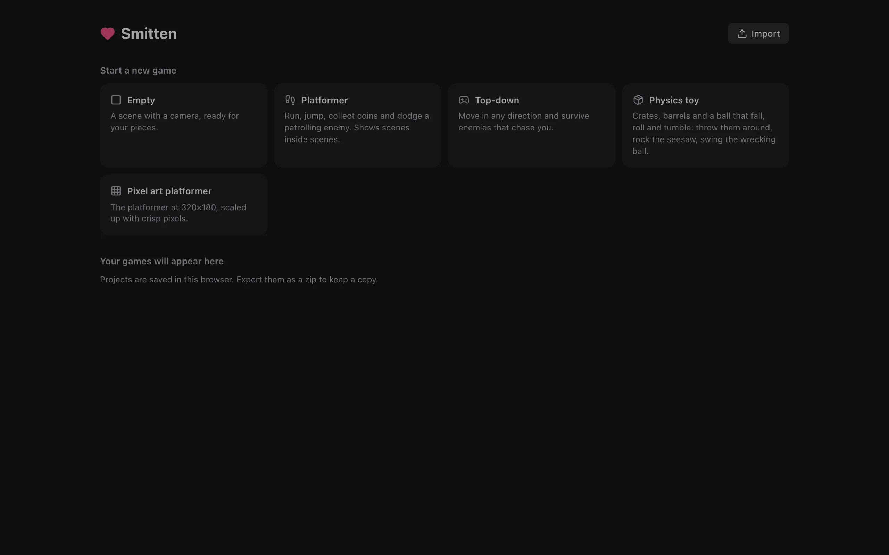
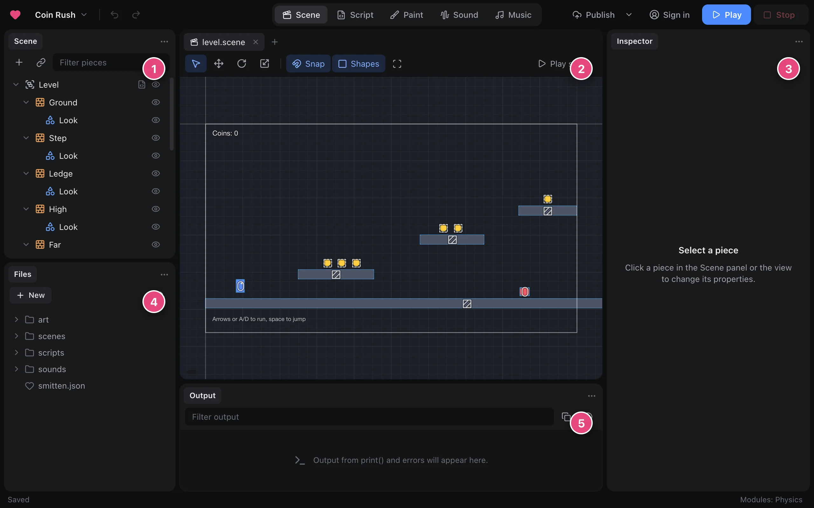
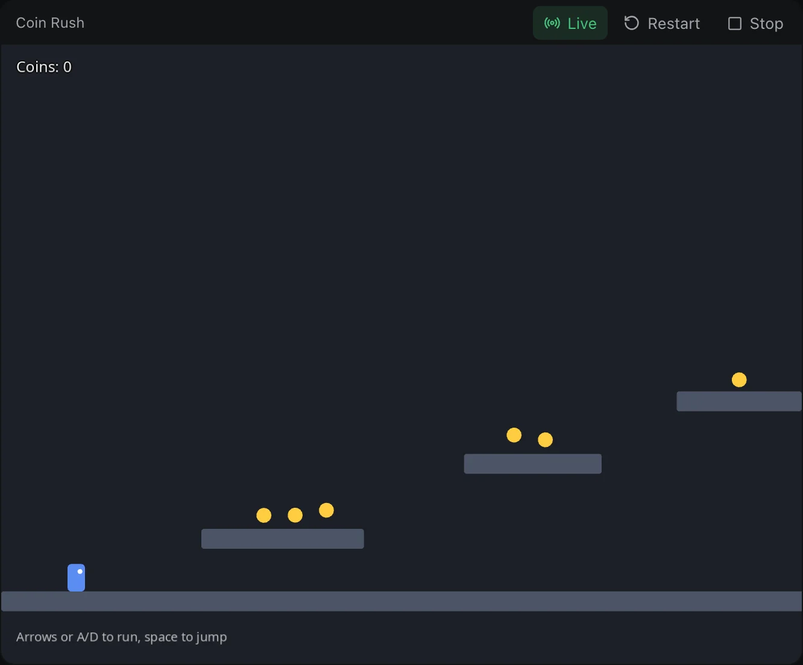
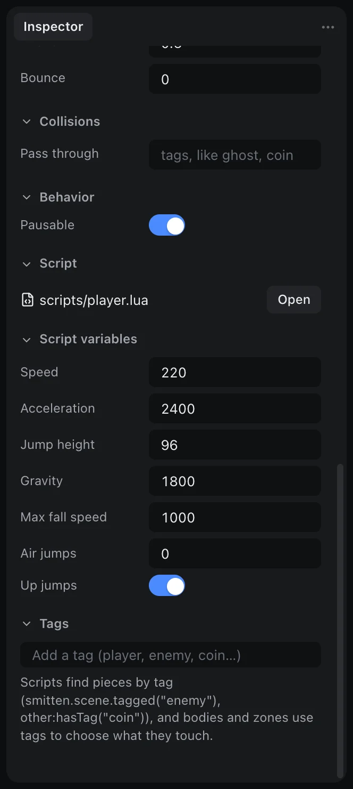
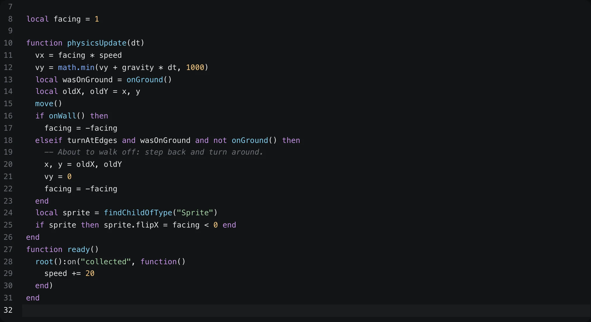
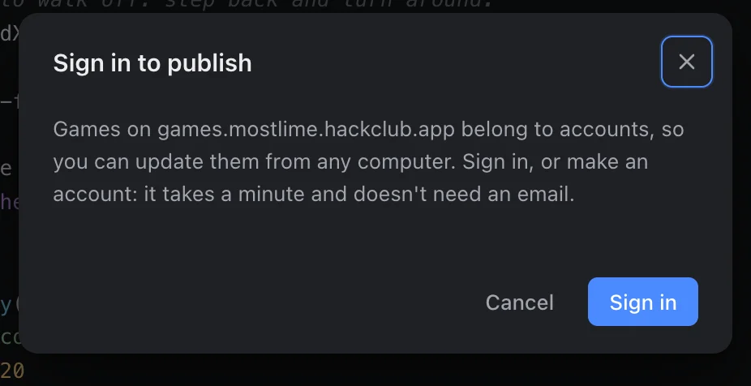

# Getting started

In this tutorial you'll make a small platformer: a player who runs and
jumps, coins to collect, and an enemy to avoid. You'll change how it plays,
write your first script, and put the game online for anyone to play. It
takes about fifteen minutes, and you don't need to know any programming
yet.

## 1. Make a game

Open the editor. The home screen lists your games and a few templates to
start from. Pick **Platformer** and give it a name.



Your game opens in the editor. Here's what you're looking at:



1. **Scene panel**: everything in the current scene, as a tree of
   **pieces**. A piece is anything in your game: the player, a coin, a
   floor, a camera, a label on the screen.
2. **Scene view**: the level itself. Click a piece to select it, drag to
   move it, scroll to zoom.
3. **Inspector**: the selected piece's settings, like its position, its
   color, or how fast it runs.
4. **Files**: everything in your project, such as scenes, scripts,
   pictures and sounds.
5. **Output**: messages from your game while it runs, including errors.

You can rearrange the panels however you like: drag a panel's tab to move
it, or pull it out into its own window.

## 2. Play it

Press **Play** at the top right (or **F5**). Run with the arrow keys or
A and D, and jump with Space. Collect the coins, and stay away from the red
enemy: touching it starts the level again.



Press **Stop** (or **F8**) to go back to editing.

## 3. Change how it plays

In the Scene panel, click **Player**. The Inspector shows the player's
settings. Near the bottom, under **Script variables**, are numbers that
control the movement: `speed`, `jumpHeight`, `gravity` and more.



Try setting `jumpHeight` to `160` and `airJumps` to `1`, then play again.
The player now jumps much higher, and can jump a second time in the air.

> **Tip:** You can change these while the game is running. Select a piece
> during play, edit it, and the game changes right away. When you stop, the
> scene goes back to how it was, so you can experiment freely and type in
> the values you like afterwards.

## 4. Add more coins

The coins are their own little scene, `scenes/coin.scene`, placed several
times in the level. To add another one, drag `coin.scene` from the Files
panel into the scene view. Change the coin scene once (its color, say) and
every coin in the level changes with it.

The counter at the top of the screen updates on its own: a script on the
level counts the coins when the game starts, and adds one each time you
pick one up.

## 5. Write a script

Scripts are what make pieces do things. Each piece can have one, written
in Lua. Let's make the enemy speed up a little every time you collect a
coin.

Select **Enemy** in the Scene panel, then click its script badge to open
`scripts/patrol.lua`. Add this at the end:

```lua
function ready()
  root():on("collected", function()
    speed += 20
  end)
end
```



`ready()` runs once when the enemy appears. `root()` is the level, and
`on("collected", ...)` listens for the event that coins send when they're
picked up. Inside a script, names like `speed` belong to the piece itself,
so `speed += 20` makes this enemy faster.

Play again and watch it hurry up as you collect coins.

> **Tip:** If something goes wrong, the error appears in Output with the
> file and line. Click it to jump straight there.

## 6. Share it

When you're happy with your game, choose **Publish** in the top bar. Sign
in (or make an account), give the game a title and a short description,
and publish. You'll get a link anyone can open to play your game in their
browser, and remix their own copy.



To put the game somewhere else, like itch.io, use **Project › Export**
instead.

## Next steps

- [Scripts](scripts.md) explains how scripts work in more depth.
- [Scenes and pieces](scenes.md) covers making, finding and removing pieces.
- [Input](input.md), [Sound and music](sound.md) and [Camera](camera.md)
  each cover one part of a game.
- [Script API](api.md) lists every function a script can use.
