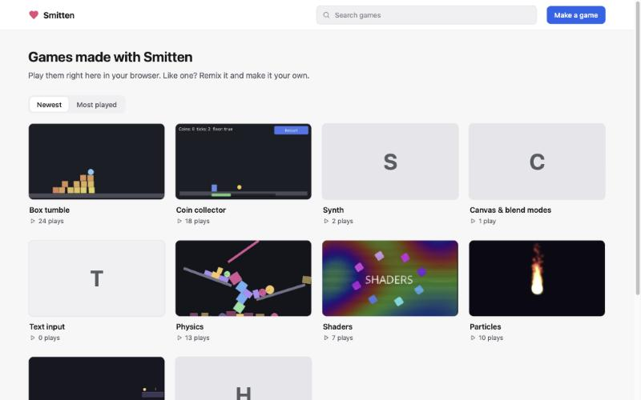
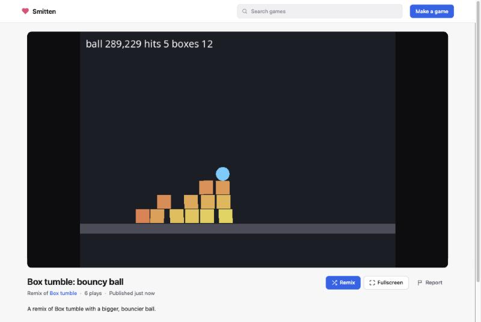

# Smitten games

A site where people publish games from Smitten's editor and anyone can play
them in the browser, in the spirit of Scratch's or Roblox's game pages. It's
a plain Node server with no dependencies: SQLite (`node:sqlite`) holds
accounts and metadata, game files sit on disk, and the gallery, the game
pages and Smitten's player are static files it serves. It's made to run on
[Hack Club Nest](https://guides.hackclub.app/), Hack Club's free hosting for
teenagers, and anywhere else Node 24 runs.

| Gallery | A game's page |
| --- | --- |
|  |  |

- **Accounts**: a username, a display name and a password (or Hack Club's
  sign-in, or both). No real names. An email is optional, and only when the
  site is set up to send mail: for password resets and account notes,
  never shown to anyone. Recovery codes work either way.
- **Publish** from the editor (`web/editor/publish.js`): signed in, with a
  title, a description and an optional thumbnail. Games belong to the
  account, so they can be updated from any computer.
- **Gallery** (`/`): newest or most played games, and search.
- **Play** (`/play/<id>`): the game in Smitten's player, who made it,
  how long it took ("Made in 12 h 30 min · tracked by Hackatime", when its
  maker connected Hackatime), **Remix** (opens the editor with a copy) and
  **Report**.
- **Profiles** (`/u/<username>`): someone's public games.
- **Account settings** (`/account`): display name, password, email, recovery
  codes, Hack Club (connect and disconnect), Hackatime, where you're signed in (browsers and editors, each can
  be signed out), your games, deleting the account.
- **Leaderboards** (optional): a game's owner can give it boards of best
  scores or fastest times; the game sends scores with `smitten.boards`
  and they show under the game. See [Leaderboards](#leaderboards).
- **Online rooms**: on its page, a game can join a room with
  `smitten.net`. Everyone in the same room of the same game gets the
  messages the others send. See [Online rooms](#online-rooms).
- **Moderation**: reports hide a game after three people report it;
  moderators hide, restore and delete games, and ban accounts.

## Running it locally

You need Node 24 or newer and a build of Smitten (`python3 build.py` in the
repository root, which writes `dist/`).

```bash
cd platform
sh scripts/copy-player.sh          # copies the player from ../dist (or pass a dist folder)
ADMIN_TOKEN=dev-admin node src/server.js
```

Open http://localhost:8787. Data goes to `platform/data/` (the database,
game files, and a generated secret); `PORT`, `DATA_DIR` and the other
settings in [`deploy/env.example`](deploy/env.example) can go in the
environment or in `platform/.env`. To fill the gallery with the editor's
templates, published by an account called "templates":

```bash
node scripts/seed.mjs http://localhost:8787
```

### Publishing from the editor, locally

The editor (http://localhost:8766) is one of the default `EDITOR_ORIGINS`,
and its **Settings › Publishing** says where the site is
(http://localhost:8787 by default). Project › Publish asks you to sign in
first. `dev/publish-harness.html` stands in for the editor, with buttons to
sign in and out: serve the repository root on port 8796 (also allowed) with
`python3 -m http.server 8796 --bind 127.0.0.1` and open
http://localhost:8796/platform/dev/publish-harness.html.

### Tests

```bash
node tools/platform-tests/test.mjs       # from the repository root
```

It starts the server on port 8788 (`PLATFORM_PORT`) with an empty data
folder, an admin token and stand-ins for Hack Club Auth, Hackatime and a
mail server (SMTP on the first free port from 8791, `SMTP_TEST_PORT`, with
STARTTLS when `openssl` can make a certificate; and, for a few checks, a
server on the next port without Hackatime or email and one with
`EMAIL_TRANSPORT=log`), and runs 194 checks: pages and headers, CORS,
signing up, in and out, passwords
and their rate limits, CSRF, recovery codes and reset links, account
settings, the editor's sign-in and its tokens, publishing, ownership,
listing, search and profiles, plays, validation and the word filter,
remixes, claiming old games, reports, moderation, banning, Hack Club
sign-in (and disconnecting it), email (confirming, changing and removing
an address, resets by email without saying who has an account, their rate
limits and address bans, account notes, retries, logs without addresses;
the SMTP client's STARTTLS, implicit TLS, AUTH PLAIN and LOGIN,
dot-stuffing, quoted-printable and timeouts; Resend's API; the log
transport; and email off), connecting Hackatime (keys, game hours and
their cache, revoked tokens, disconnecting, encryption at rest),
leaderboards (making and managing boards, who may, guests and accounts,
best and every score, low boards and ties, bounds, bad values and names,
big bodies, rate limits, hidden games, bans, the stored-score cap,
deleting boards, games and accounts, and a database from before
leaderboards), deleting games and accounts, and rate limits.

`node --experimental-websocket tools/platform-tests/boards-e2e.mjs <dist>`
is a check by hand, not part of the tests: it copies a built player in,
starts the site on a spare port, publishes a small game that sends a score
and reads the board back, and plays it on its page in headless Chromium
(the file says what it needs). `PLATFORM_URL` tests a running server instead (it needs
`TRUST_PROXY=1` and `PUBLIC_URL` set to that address; tests that need the
database or the stand-ins are skipped).

## How it works

```
platform/
  src/server.js            Node's http server: routing, pages, static files, the player's URL check
  src/config.js            settings (deploy/env.example)
  src/db.js                SQLite, migrations, ids, tokens, rate limits
  src/auth.js              passwords (scrypt), sessions, editor tokens, CSRF and sign-in checks
  src/account.js           sign up/in/out, recovery, settings, profiles, claiming, the editor's sign-in
  src/email.js             email on accounts: confirming, resets by email, account notes
  src/mail.js              sending mail: the queue, SMTP, Resend, the log
  src/hackclub.js          Sign in with Hack Club (OpenID Connect), disconnecting it
  src/hackatime.js         Connect Hackatime (OAuth): the editor's API key, game hours
  src/games.js             publishing, playing, listing, reporting
  src/boards.js            leaderboards: boards, scores, their limits
  src/admin.js             moderation
  src/storage.js           game files on disk
  src/validate.js          titles, descriptions, usernames, passwords, the word filter, PNGs, modules
  src/zip.js               game zip checks
  src/http.js              JSON, cookies, security headers, CORS
  src/compress.js          Brotli and gzip for static files and pages
  migrations/              the schema, applied in order on start
  config/blocked-words.json the word filter's list
  public/                  the pages and their scripts, site.css
  public/player/           Smitten's player (copied, not in git)
  scripts/                 copy-player.sh, precompress.mjs, seed.mjs, admin.mjs, backup.mjs
  deploy/                  env.example, systemd units, an optional Caddyfile
  dev/publish-harness.html stand-in for the editor
```

- **Storage.** `<DATA_DIR>/smitten.db` (SQLite in WAL mode) has `users`,
  `sessions`, `editor_codes`, `recovery_codes`, `password_resets`, `games`,
  `reports`, `plays`, `rate_limits`, `admin_log`, `address_bans`,
  `user_addresses`, `email_tokens`, `mail_queue`, `boards` and `scores`.
  `<DATA_DIR>/games/<id>/game.love` (the source), `play.love` (the play
  build, when the game has one) and `thumbnail.png` are the files,
  written to a temporary file and renamed so a download never sees half of
  one. Migrations (`migrations/NNNN_*.sql`) run on start; `PRAGMA
  user_version` says which have.
- **Playing.** `/play/<id>` is `play.html` with the title and description
  filled in for link previews. `play.js` puts the player in a sandboxed
  iframe: `/player/player.html?game=/api/games/<id>/play/<title>.zip&modules=physics2d`.
  That is the play build, which the editor makes when it publishes
  (smaller images and files, `docs/sharing.md`); a game published before
  play builds runs from its source there.
  The server refuses a `?game=` that isn't one of this site's games, so the
  player can't run games from elsewhere. The sandbox has no `allow-popups`
  or `allow-top-navigation`.
- **Plays** count once per person per game per day: per account when signed
  in, otherwise per address.
- **Updates** replace the game, its metadata and its thumbnail and bump
  `version`; the id, plays and `remixOf` stay. A hidden game stays hidden.

## Leaderboards

Optional, per game, and for fun: **scores come from the game running in
the player's browser, so anyone who wants to can send a made-up one.** The
server can't tell a real score from a fake one; it keeps scores within
bounds and gives the owner the tools to clean up. Don't hang prizes on
them. The user docs say the same (`docs/leaderboards.md`).

- **Boards.** A game has zero to `BOARDS_PER_GAME` (10) boards, made by
  its owner on the account page (*Your games › Leaderboards*) or through
  the API. A board has a `key` (1 to 24 of `a-z 0-9 - _`, unique in the
  game; scripts use it), a `title` (40 characters, word filter), `order`
  (`high`: bigger is better, the default; `low` for times), `keep`
  (`best`: one row per player, their best, the default; `all`: every
  score), `format` (`number`, or `time`: seconds shown as `1:23.45`), a
  `unit` shown after numbers (12 characters), and optional `min` and `max`
  bounds on scores. Tables: `boards` (one row each) and `scores`
  (`board_id`, `player`, `user_id`, `name`, `value`, `created_at`).
- **Who the player is.** With the site's session cookie, the account:
  `player` is `u:<id>`, and the name shown is the account's display name
  as it is now. Otherwise a guest: the name the game passes (1 to 12
  letters, numbers, spaces, `-` and `_`, through the word filter; "Guest"
  when none), and `player` is `g:` plus an HMAC of the address and the
  lower-cased name with the server's secret. Addresses are never stored.
  Rows say `guest: true` so pages can tell the two apart (a guest can call
  themselves anything the filter allows, including someone else's name).
- **Sending a score** (`POST …/scores`): only from the site's own pages
  (`Origin`), JSON of at most 1 KB, to a public game. The value must be a
  JSON number (not text, `null`, or beyond ±10^12), inside the board's
  `min`..`max`, and is rounded to two decimals. Per hour: `SCORE_LIMIT_PER_HOUR`
  (120) per account and `SCORE_ADDRESS_LIMIT_PER_HOUR` (300) per address,
  then 429. A banned network can't send scores; a banned account is signed
  out, and its scores are left out of lists and ranks until it's unbanned.
- **What's kept.** A board keeps its best `BOARD_MAX_SCORES` (1000)
  scores; a score that doesn't make it answers `kept: false`. Equal scores
  share a rank, the earlier one listed first.
- **Cleaning up.** The owner (session or editor token) and moderators (the
  admin token, logged) can change a board, **reset** it (remove every
  score), delete it, and remove one score. The game's page shows its owner
  a Remove button on every row. A board's `order` can only change while it
  is empty. A hidden game's boards are hidden with it and take no scores.
  Deleting a game deletes its boards and scores; deleting an account also
  deletes its scores on other people's boards.
- **On the game's page**, boards show under the game: a tab per board, the
  top ten, and the viewer's own place when it's further down.

### How a game reaches its boards

Games have no network access, and that stays. `smitten.boards` (the
engine's `love/src/modules/boards`) reaches the site through two small
hops, neither of which the game controls:

1. The game's call leaves the engine as a printed line (`\x01site {json}`).
   The player (`web/player/player.js`) passes it to the page that frames
   it with `postMessage`, and passes answers back into the engine through
   the queue live tweaking already uses. The player makes no request
   itself and has no URL to make one to. It only does this when `play.js`
   added `?site=1`, and only talks and listens to a parent page on its own
   origin, so in the editor, in an exported game or opened by itself
   there is no bridge and `smitten.boards.available()` is false.
2. The game's page (`public/play.js`) takes `{call: "submit" | "top" |
   "around" | "list", key, value, name, count}` and makes the matching
   request to **this game's** leaderboard endpoints: the game id is the
   page's own, the key must match the key pattern, the count is clamped,
   and at most four requests run at once. The answer is cut down to plain
   rows (`rank`, `name`, `value`, `me`, `guest`) or one word for a failure.

So a game's Lua can cause exactly these requests: read its own game's
boards, and send a score to them, with values the server checks as it
would anyone's. It never sees cookies, tokens, headers or other
responses, and can't name a URL, a method or another game. The player
still shares the site's origin (see [Limits](#limits-of-this-version));
the bridge doesn't widen that: a game that escaped the engine could
already use the session cookie, and one that hasn't can only do the above.
If the player moves to its own origin, the bridge keeps working: it is
already a `postMessage` hop, and the two origin checks (`SITE_ORIGIN` in
`player.js`, `location.origin` in `play.js`'s `fromGame`) become the
other side's origin, passed in the iframe's URL.

## Online rooms

A relay for `smitten.net` (`src/rooms.js`, user docs in `docs/online.md`).
It only carries messages: it does not check what a game sends, decide
anything for the game, or keep anything. Rooms live in the memory of the
server process. A restart ends them all, and the games get
`disconnected("lost")`.

- **The connection.** The game's page (`public/play.js`), not the game,
  opens a WebSocket to `/api/games/<id>/rooms/<room>?max=&name=` on the
  site's own origin. The server accepts only an `Origin` equal to
  `PUBLIC_URL`, and only public games. The player passes messages between
  the game and the page, as for leaderboards. The game never gets a URL.
  The upgrade comes in through the server's `upgrade` event, and
  `src/rooms.js` speaks WebSocket itself (text frames only, no
  compression, frames up to 64 KB).
- **Rooms.** A room name is 1 to 32 letters, numbers, spaces, `_ . -`, and
  case does not matter. Each game has its own names. The first player
  makes the room and sets its size (2 to `ROOM_MAX_PLAYERS`, 16; 8 when
  the game gives none). Peers get ids 1, 2, 3... in the order they come.
  The host is the peer that is in the room the longest. A room ends when
  its last peer leaves.
- **Names.** With the session cookie, the account's display name.
  Otherwise the name the game gives, through the same checks as a
  leaderboard guest's name ("Guest 3" when there is none).
- **Messages.** `{t: "to", to, d}` and `{t: "all", d}` from the page;
  `welcome`, `joined`, `left`, `msg` and `warn` from the server (the
  comment at the top of `src/rooms.js` lists the fields). The server reads
  only `t` and `to`, and never writes message data to the log.
- **Limits** (all in `deploy/env.example`): `ROOM_MESSAGE_BYTES` (8192)
  per message, `ROOM_MESSAGES_PER_SECOND` (30) and
  `ROOM_BYTES_PER_SECOND` (32 KB) per peer (messages over them are
  dropped, with a `warn`), `ROOMS_PER_GAME` (100), `ROOM_CONNECTIONS`
  (1000) on the server and `ROOM_CONNECTIONS_PER_ADDRESS` (8). A page
  that does not read its messages (1 MB waiting) is closed with `slow`. A
  room with no message for `ROOM_IDLE_SECONDS` (15 minutes) closes. The
  server pings every `ROOM_PING_SECONDS` (20) and drops a connection that
  does not answer. A banned network cannot join rooms. `ROOMS=off` turns
  rooms off (games get `"unavailable"`).
- **Dropped connections.** Close code 1000 or 1001 from the page is a
  leave. A connection that ends without one keeps its place for
  `ROOM_GRACE_SECONDS` (10). The page tries again with the token from its
  `welcome` (`&resume=`), and gets a new `welcome`. Messages in between
  are lost.

## Accounts

- **Signing up** takes a username (3 to 20 characters: lower-case letters,
  numbers, `-` and `_`; not reserved names like "admin"; through the word
  filter, look-alike letters included), an optional display name (40
  characters, word filter) and a password (8 to 200 characters; not a
  common one, not containing the username), and, only when the site sends
  mail, an optional email (see [Email](#email)). No age, no real name; the
  sign-up page says to use a nickname. Five sign-ups per address and hour.
- **Passwords** are hashed with scrypt (N = 2^15, r = 8, p = 1, a 16-byte
  salt), about 50 ms each. Ten failed sign-ins lock an account for the rest
  of the hour, from any address; each address gets 30 sign-in attempts an
  hour. A sign-in with an unknown username takes as long as a real one.
- **Sessions** are a cookie, `smitten_session`: a random 256-bit token
  (only its SHA-256 is stored), `HttpOnly`, `SameSite=Lax`, `Secure` on
  https, 30 days after last use. Requests that change anything with the
  cookie must come from the site's own pages (`Origin`, or
  `Sec-Fetch-Site: same-origin`), so other sites can't use it (CSRF).
  Changing the password or resetting it signs out everywhere else.
- **Recovery.** Three ways, all at `/recover`: eight **recovery codes**
  shown once at sign-up (copy or download, and a checkbox before
  continuing), each resetting the password once, renewable in settings; a
  **reset link by email** (1 hour) when the account has a confirmed email
  and the site sends mail; and a one-time **reset link** from a moderator,
  valid for a day (`node scripts/admin.mjs reset-link <username>`), for
  someone who lost the rest. Accounts made with Hack Club recover through
  Hack Club.
- **Sign in with Hack Club**, through [Hack Club Auth's OpenID
  Connect](https://auth.hackclub.com/docs/oidc-guide), when
  `HACKCLUB_CLIENT_ID` and `HACKCLUB_CLIENT_SECRET` are set: the
  authorization code flow with `state` and PKCE, the code swapped with the
  client secret, and the `sub` from the userinfo endpoint. Only `sub` is
  kept (scope `openid`, so no name or email is even asked for). Someone new
  picks a username next; an existing account can connect Hack Club in its
  settings (the sign-up page says how), and **disconnect** it there
  (`DELETE /api/account/hackclub`, with the password) as long as it has a
  password to sign in with. A Hack Club account sets a password first
  (which also gives it recovery codes). Register the app at
  https://auth.hackclub.com/developer/apps with the redirect URI
  `<PUBLIC_URL>/auth/hackclub/callback`.
- **Connect Hackatime**, when `HACKATIME_CLIENT_ID` and
  `HACKATIME_CLIENT_SECRET` are set: see [Hackatime](#hackatime) below.
- **Games belong to accounts.** Publishing, updating and deleting need the
  owner's session or editor token. Games published before accounts (with
  an edit token) have no owner until claimed.
- **Claiming.** The editor keeps the edit tokens of games it published
  before accounts. When someone signs in, it sends them
  (`POST /api/account/claim`), and the games whose token matches and that
  have no owner yet become theirs; their tokens stop working.
- **Profiles** show the display name, username, join date and public games.
  Nothing else is public.
- **Deleting an account** (password, or typing the username for Hack Club
  accounts without one) deletes its games and their files right away.

### Email

Off unless `EMAIL_TRANSPORT` is set (see [Email on Nest](#email-on-nest)).
When it's on:

- **An email is optional**, at sign-up or in account settings (add,
  change, remove; changing and removing ask for the password, if the
  account has one). It's only shown to its owner on the site: not on
  profiles, not to the editor, and moderators only see it masked
  (`k***@g***.com`).
- **Confirmed by a link** (`/verify-email#token=…`, 24 hours, single use,
  only the token's SHA-256 stored). Until then the address waits in
  `email_tokens` and is used for nothing else; only a confirmed address
  can get reset links. A confirmed address belongs to one account
  (lower-cased, unique). Changing it keeps the old one until the new one is
  confirmed, then tells the old one; removing it tells the removed one.
  Either way, reset links already sent stop working.
- **No one learns who has an account.** Adding an address that's already
  on another account gets the same answer as any other; the address gets
  a note ("it's already on your account") instead of a link. Asking for a
  reset link always answers "if it's on an account, we've sent a link".
- **Reset by email** at `/recover`: a link to `/recover#reset=…`, 1 hour,
  single use, which also says the username (people forget it). Limits per
  hour: 10 requests per network, 3 per address (whether or not it's on an
  account, so a 429 says nothing), 3 per account (silently: no mail, same
  answer). A network a moderator banned can't ask. Banned accounts get
  nothing.
- **Account mail**, and nothing else: confirming an address, password
  resets, "your password was changed", "your email was changed / removed",
  "a moderator hid your game" and "your game is back" (admin hide and
  restore). Plain text and simple HTML in the site's look, no images, no
  tracking, no unsubscribe-worthy marketing. Limits: 5 confirmation mails
  per account and hour, 3 per address.
- **Sending never holds up a request.** Messages go into `mail_queue`
  and a worker in the server sends them one at a time, retrying with
  backoff (30 s, 2 min, 8 min, … up to 8 attempts); 5xx answers (and 4xx
  from Resend) are final. A message is deleted once sent, given up on, or
  past its link's expiry (a day at most), and when its account is deleted.
  Failures are logged as `Mail #<n>: …` with the reason, never an address,
  link or body.
- **SMTP** (`src/mail.js`, no dependencies): STARTTLS on 587 (refusing to
  send the password if the server doesn't offer it), implicit TLS on 465,
  AUTH PLAIN or LOGIN, dot-stuffing, CRLF, quoted-printable UTF-8,
  `multipart/alternative`, `Message-ID`, `Date`, `Auto-Submitted`, and a
  timeout on every step (`EMAIL_TIMEOUT_SECONDS`, 20).

### The editor's sign-in

The editor runs on another origin, so it never sees the password or the
site's cookie. It gets an **editor token** instead:

1. The editor makes a random `verifier` and `state` and opens a popup at
   `/editor-auth?origin=<its origin>&state=<state>&challenge=<base64url SHA-256 of the verifier>`.
   It opens the popup right in the click, before anything asynchronous,
   so browsers don't block it.
2. If the person isn't signed in on the site, the popup takes them through
   sign-in or sign-up and back. It then shows which editor is asking and
   for which account, and what it can do. Only origins in `EDITOR_ORIGINS`
   are accepted.
3. On **Allow**, the page asks the site for a one-time code
   (`POST /api/auth/editor/code`: needs the session cookie, same-origin)
   bound to the account, the editor's origin and the challenge, good for
   five minutes, and posts `{state, code}` to `window.opener` with
   `targetOrigin` set to that origin, so no other window can receive it.
   The sign-in pages are served without `Cross-Origin-Opener-Policy` so the
   popup keeps its opener.
4. The editor checks the message came from the site's origin with its
   `state`, and swaps the code and the verifier for a token
   (`POST /api/auth/editor/token`, CORS). The site checks the verifier
   against the challenge, that the request's `Origin` is the one the code
   was made for, and uses the code up whatever happens.

If the popup loses track of the editor (some sign-in pages cut a popup off
from its opener), it shows the code to paste into the editor's waiting
dialog instead; without the editor's verifier the code is useless to
anyone else. Editor tokens are 256-bit bearer tokens (stored as SHA-256),
valid for 90 days after their last use, at most 20 per account. They can
publish, update and delete the account's games, list them, and claim old
ones, but not change the password, the display name or delete the account;
account settings list them ("The editor at …") with **Sign out**, and
changing the password revokes them. CORS headers go only to
`EDITOR_ORIGINS`, never with credentials.

## Hackatime

[Hackatime](https://hackatime.hackclub.com) is Hack Club's time tracker.
The editor sends it heartbeats with the person's API key
(`web/editor/hackatime.js`). Connecting it to a Smitten account does two
things: the editor gets the key with one click instead of copying it, and
game pages show how long Hackatime tracked for the game.

**Setting it up.** Register a confidential OAuth app in Hackatime with the
scopes `profile` and `read` and the redirect URI
`<PUBLIC_URL>/auth/hackatime/callback` (in production,
`https://games.mostlime.hackclub.app/auth/hackatime/callback`), and set
`HACKATIME_CLIENT_ID` and `HACKATIME_CLIENT_SECRET` (`HACKATIME_URL` points
elsewhere, for testing). Without them, the account row, the routes and the
hours are off (`/api/config` says `accounts.hackatime: false`).

**Connecting.** `/auth/hackatime` (signed in on the site; otherwise it goes
through sign-in first) sends the browser to Hackatime's
`/oauth/authorize` with `state` and PKCE (S256), scope `profile read`; the
callback swaps the code for an access token with the client secret, asks
`/api/v1/authenticated/me` for the Hackatime user id, and stores it. It
ends on `/account?connected=hackatime`, or on `next` (the editor uses
`/hackatime-connected`, which says to go back to the editor). A Hackatime
account is connected to one Smitten account at a time; connecting it to
another moves it there.

**From the editor.** Settings › Hackatime › **Connect with Hackatime**
signs in to the site if needed, asks `GET /api/account/hackatime-key`, and
if the account isn't connected yet, opens `/auth/hackatime?next=/hackatime-connected`
in a window and asks again every 2 seconds (for up to 3 minutes, while
Settings is open). The site fetches the key from Hackatime's
`/api/v1/authenticated/api_keys` each time and doesn't keep it. Pasting a
key by hand still works.

**Game hours.** The editor sends its project's name with each publish
(`meta.hackatimeProject`; it's the `project` its heartbeats name). When the
game's owner has Hackatime connected, the game's view has
`hackatime: {seconds, checkedAt}`, from a cache on the game, refreshed in
the background from `/api/v1/authenticated/projects?projects=<name>` at
most once an hour per game (when someone looks at it), and right after
publishing, updating or connecting. If Hackatime is down, the page shows
the last value, or none. The project name itself isn't shown.

**What's stored, and privacy.** On the account: the Hackatime user id, the
access token, and when it was connected. The token is encrypted with
AES-256-GCM, with a key derived from `SECRET` and the account's id as
associated data; it's never logged or sent to a browser. Nothing else from
Hackatime (`/me` also returns emails, a Slack id and a GitHub username) is
kept, and the API key isn't stored at all. On games: the project name and
the cached seconds. **Disconnecting** (account settings, or
`DELETE /api/account/hackatime` from the editor) revokes the token at
Hackatime (best effort) and clears all of it, cached hours included;
deleting the account revokes it too. When Hackatime says a token was
revoked (from Hackatime's side), the link is cleared the next time it's
used. Changing `SECRET` makes stored tokens unreadable, which disconnects
everyone (they connect again).

## The editor's side

`web/editor/account.js`:

```js
import { account, signIn, signOut, onChange, accountEvents } from './account.js';

account();                      // {username, displayName, hasPassword, hackclub, hackatime, createdAt} or null
await signIn();                 // from a click: opens the popup; the user, or null if cancelled
await signOut();                // revokes the editor's token on the site
const off = onChange((user, platformUrl) => { /* update the account button */ });
```

Each takes an optional platform URL (`signIn({platformUrl})`), defaulting
to the editor's `platformUrl` setting; accounts are kept per site in
localStorage (`smitten-editor.account`). `onChange` also fires for changes
in other tabs and when the `platformUrl` setting changes. It also exports
`refreshAccount()` (asks the site, e.g. after a revoked token),
`accountToken()`, `clearAccount()` and `accountRequest(path, {method, body})`
(calls the site's API with the editor's token). It uses only `ui.js` and
`settings.js`, and existing classes, so it needs no CSS of its own.

`web/editor/publish.js`:

```js
import { publishDialog, fetchRemix, rememberRemix } from './publish.js';

await publishDialog(project, { files: project.snapshot(), modules: includedModules(project), platformUrl });
const { name, files, remixOf } = await fetchRemix(platformUrl, id);   // <editor>#remix=<id>
```

- `publishDialog` asks you to sign in when you aren't (or the site signed
  the editor out), shows **Publishing as <name> (@username)** with Switch
  account and Sign out, and resolves with `{id, url, version}`,
  `{deleted: id}` or `null`.
- Which game each project was published as is in localStorage under
  `smitten-editor.published` (`{[gameId]: {projectId, owner, title, url, ...}}`).
  Publishing a project that's in there updates its game, if it's yours.
- On sign-in it claims this browser's old games (`claimLocalGames()`) and
  says how many it added.
- `fetchRemix` names the copy "<title> (remix)"; `rememberRemix(projectId,
  gameId)` makes its first publish record `remixOf`.

## API

All responses are JSON, except the game file, the thumbnail and the
`/auth/hackclub` redirects. Errors are `{"error": "a sentence for people",
"field": "title"}` with a 4xx status, and `code` where the editor needs to
tell cases apart (`sign-in`, `signed-out`, `banned`, `use-hackclub`,
`bad-code`, `not-connected`, `hackatime-off`, `email-off`, `bad-link`,
`email-taken`, `nothing-pending`, `needs-password`, `address-banned`,
and for leaderboards `no-board`, `bad-value`, `out-of-range`, `bad-name`,
`hidden`, `too-many-boards`, `not-empty`). "Session" means the cookie from a page on this site; "editor"
means `Authorization: Bearer <editor token>`.

| Endpoint | Who | What it does |
| --- | --- | --- |
| `GET /api/config` | anyone | Editor URL and origins, report reasons, modules, limits, `accounts.hackclub`, `accounts.hackatime`, `accounts.email` |
| `GET /api/games?sort=new\|popular&q=&user=&limit=24&cursor=` | anyone | Public games, newest or most played; `q` searches titles and descriptions, `user` filters by username |
| `POST /api/games` | session or editor | Publish: `multipart/form-data` with `meta` (JSON: `title`, `description`, `modules`, `engineVersion`, `remixOf`, `hackatimeProject`), `game` (the project as a zip), optionally `play` (the play build as a zip: the play page runs it, remixes get `game`) and `thumbnail` (PNG). `201 {id, game}` |
| `GET /api/games/<id>` | anyone | A game, with `owner`, `remixOf: {id, title}`, `remixes` and `hackatime: {seconds, checkedAt}` (when tracked); `yours: true` for its owner |
| `PUT /api/games/<id>` | owner | Publish an update (the same form; without `hackatimeProject`, the game keeps its; without `play`, the old play build is removed) |
| `DELETE /api/games/<id>` | owner | Delete the game and its files |
| `GET /api/games/<id>/<name>.zip` | anyone | The game's source (`application/zip`, as an attachment; ETag and 304s). Older `<name>.love` links still work |
| `GET /api/games/<id>/play/<name>.zip` | anyone | The play build, or the source if the game has none (`playSize` in `GET /api/games/<id>` is `null` then) |
| `GET /api/games/<id>/thumbnail.png` | anyone | The thumbnail |
| `POST /api/games/<id>/play` | anyone | Count a play |
| `POST /api/games/<id>/report` | anyone | Report: `{reason, note}` |
| `GET /api/games/<id>/boards` | anyone | The game's leaderboards: `{boards: [{key, title, order, keep, format, unit, min, max, scores}], limit}` (also `boards` in `GET /api/games/<id>`) |
| `POST /api/games/<id>/boards` | owner (session or editor) or admin | Make a board: `{key, title, order, keep, format, unit, min, max}` (only `key` and `title` are needed). 409 past `BOARDS_PER_GAME` |
| `GET /api/games/<id>/boards/<key>?limit=10&around=1&name=` | anyone | The top scores (`limit` up to 100): `{board, scores: [{id, rank, name, value, at, me, guest, username}], you: {rank, value}}`. `around=1` centres on the asker's own score; `name` is a guest's name, to mark their rows |
| `PATCH /api/games/<id>/boards/<key>` | owner or admin | Change `title`, `order` (empty boards only), `keep`, `format`, `unit`, `min`, `max` |
| `POST /api/games/<id>/boards/<key>/reset` | owner or admin | Remove every score |
| `DELETE /api/games/<id>/boards/<key>` | owner or admin | Delete the board and its scores |
| `POST /api/games/<id>/boards/<key>/scores` | the site's pages | Send a score: `{value, name}` (`name` for guests). `201 {value, rank, improved, kept}` |
| `DELETE /api/games/<id>/boards/<key>/scores/<score id>` | owner or admin | Remove one score |
| `GET /api/games/<id>/rooms/<room>` (WebSocket) | the site's pages | An online room: see [Online rooms](#online-rooms) |
| `GET /api/users/<username>` | anyone | A profile: `{username, displayName, createdAt, games}` |
| `POST /api/auth/signup` | the site's pages | `{username, displayName, password, email}` (or `{via: "hackclub", username, email}` after Hack Club; `email` optional, ignored when email is off). Sets the session; `201 {user, recoveryCodes, pendingEmail}` |
| `POST /api/auth/signin` | the site's pages | `{username, password}`. Sets the session |
| `POST /api/auth/signout` | session | Ends it |
| `POST /api/auth/recover` | the site's pages | `{username, code, password}` or `{resetToken, password}` (a link by email or from a moderator). Signs out everywhere, then in here |
| `POST /api/auth/recover/email` | the site's pages | `{email}`: a reset link to it if it's confirmed on an account. Always `{ok: true}` |
| `POST /api/auth/verify-email` | the site's pages | `{token}` from a confirmation link: `{ok, username, email}`. No session needed |
| `POST /api/auth/editor/code` | session | `{origin, challenge}`: a one-time code for the editor's popup |
| `POST /api/auth/editor/token` | editor origin | `{code, verifier}`: `{token, user}` |
| `DELETE /api/auth/editor/token` | editor | Sign the editor out |
| `GET /api/account` | session or editor | `{user, via}` or `{user: null}` (401 for an editor token that no longer works); with a session also `recoveryCodesLeft`, `email` and `pendingEmail: {address, expiresAt}` |
| `PATCH /api/account` | session | `{displayName}` |
| `DELETE /api/account` | session | `{password}` or `{confirm: username}`: delete the account and its games |
| `POST /api/account/password` | session | `{current, password}`: change (or set) it; signs out everywhere else |
| `POST /api/account/recovery-codes` | session | `{password}`: eight new codes |
| `POST /api/account/email` | session | `{email, password}`: add or change it (confirmed by a link first). `{email, pendingEmail}` |
| `DELETE /api/account/email` | session | `{password}`: remove it (and any waiting); works when email is off too |
| `POST /api/account/email/resend` | session | A new confirmation link for the address waiting |
| `POST /api/account/email/cancel` | session | Forget the address waiting |
| `DELETE /api/account/hackclub` | session | `{password}`: disconnect Hack Club (409 `needs-password` without a password) |
| `GET /api/account/sessions` | session | Where you're signed in |
| `DELETE /api/account/sessions/<id>` | session | Sign one out |
| `POST /api/account/sessions/revoke-others` | session | Sign out everywhere else |
| `GET /api/account/games` | session or editor | Your games, hidden ones too, with `status` |
| `POST /api/account/claim` | session or editor | `{games: [{id, token}]}`: claim games published with edit tokens |
| `GET /api/account/hackatime-key` | editor or session | `{key}`: the Hackatime API key, fetched from Hackatime (`no-store`). 404 `{code: "not-connected"}` when not connected, `{code: "hackatime-off"}` when the site has no Hackatime |
| `DELETE /api/account/hackatime` | session or editor | Disconnect Hackatime (and revoke the token there) |
| `GET /auth/hackclub?next=&link=1` | anyone | Off to Hack Club's sign-in (when configured) |
| `GET /auth/hackclub/callback` | Hack Club | Back from it |
| `GET /auth/hackatime?next=` | session | Off to Hackatime to connect it (when configured) |
| `GET /auth/hackatime/callback` | Hackatime | Back from it |

Moderation, with `Authorization: Bearer <ADMIN_TOKEN>` (or
`node scripts/admin.mjs`, which calls them on the same machine):

| Endpoint | What it does |
| --- | --- |
| `GET /api/admin/reports` | Hidden and reported games, with owners and open reports |
| `POST /api/admin/games/<id>/hide` | Hide a game (its owner gets an email, if they have one) |
| `POST /api/admin/games/<id>/restore` | Make it public again and close its reports (and tell its owner) |
| `DELETE /api/admin/games/<id>` | Delete it |
| `GET /api/admin/users/<username>` | An account: status, how it signs in, its email (masked) and whether one waits, its games |
| `POST /api/admin/users/<username>/ban` | `{reason}`: sign it out everywhere, hide its public games and profile, block sign-in |
| `POST /api/admin/users/<username>/unban` | Lift the ban; games the ban hid come back |
| `POST /api/admin/users/<username>/reset-password` | A one-time reset link, valid a day |
| `DELETE /api/admin/users/<username>` | Delete the account and its games |
| `GET /api/admin/log` | What moderators did |
| `GET /api/admin/request` | The client address the server sees (to check `TRUST_PROXY`) |

Hidden games return 404 with `"hidden": true` to everyone except their
owner and admins.

## Safety

The audience is teenagers:

- **Little personal data.** Accounts are a username, a display name and a
  password hash (or a Hack Club id), and, if connected, a Hackatime id and
  an encrypted Hackatime token, and, if the person adds one, a confirmed
  email (plus one waiting for confirmation, for 24 hours at most), used
  only for account mail and shown to no one else. Mail waiting to go out
  sits in `mail_queue` for a day at most. No real name, no age, no
  profile pictures, no comments or messages: people can't contact each
  other through the site. IP addresses are only stored as salted hashes,
  in rate limits and anonymous reports and plays.
- **Reports.** Every game page has Report, with reasons and an optional
  note. Each reporter (account, or address when signed out) counts once per
  game. When `REPORT_THRESHOLD` (3) different reporters have open reports,
  the game is hidden from the gallery, search, profiles and its page, and
  its files stop being served, until a moderator restores it (closing the
  reports) or deletes it.
- **Bans** sign an account out everywhere, block signing in and recovery,
  hide its profile and public games, and are logged.
- **Limits.** Games up to 25 MB (256 MB unpacked, 10,000 files);
  thumbnails 1 MB and 4096×4096; titles 60 characters, descriptions 1000,
  report notes 500, display names 40. Request bodies past the limit are
  cut off as they arrive. Publishing: 10 an hour per account. Reports: 20
  an hour per address and per account. Leaderboards: 10 boards a game,
  1000 scores a board, 120 scores an hour per account and 300 per
  address, score requests of 1 KB. Online rooms: see [Online rooms](#online-rooms).
- **Zip checks.** A plain zip (no encryption, ZIP64 or unusual
  compression) with `smitten.json` at its root, no absolute
  or `..` paths. Thumbnails must be real PNGs.
- **Word filter** on titles, descriptions, usernames and display names
  (`config/blocked-words.json`): whole words with endings, look-alike
  characters, spaced or dotted letters, stretched letters, some strings
  inside words, and phrases. Control and invisible characters are removed.
- **Headers.** `nosniff`, a `Content-Security-Policy` (pages: only the
  site's own scripts, never framed; the player: framed only by the site,
  `connect-src` limited by `GAME_NETWORK`; files and JSON: `sandbox`), a
  `Referrer-Policy` (`no-referrer` on sign-in pages), a
  `Permissions-Policy` without camera, microphone or location, and HSTS on
  https.

## Configuration

Every setting is an environment variable, also read from `platform/.env`
(or the file in `ENV_FILE`). [`deploy/env.example`](deploy/env.example)
lists them all with their defaults; the ones to set when deploying are
`PUBLIC_URL`, `PORT`, `HOST`, `TRUST_PROXY`, `DATA_DIR`, `EDITOR_URL`,
`EDITOR_ORIGINS` and `ADMIN_TOKEN`, plus `HACKCLUB_CLIENT_ID` and
`HACKCLUB_CLIENT_SECRET` for Hack Club's sign-in and
`HACKATIME_CLIENT_ID` and `HACKATIME_CLIENT_SECRET` for Hackatime, and
`EMAIL_TRANSPORT`, `EMAIL_FROM` and `RESEND_API_KEY` (or `SMTP_*`) for
email. `SECRET` is generated into `DATA_DIR/secret` if not set. The server
refuses to start when `EMAIL_TRANSPORT` is set but its settings are
incomplete, and prints whether email is on.

## Deploying on Hack Club Nest

What Nest gives you, from its guides:

- A Linux container (Debian or Ubuntu) with 2 cores, 2 GB of memory and
  16 GB of storage by default, more on request; no public IPv4, but a
  reverse proxy for http(s)
  ([Limitations](https://guides.hackclub.app/index.php/Limitations),
  [FAQ](https://guides.hackclub.app/index.php/Frequently_Asked_Questions),
  [Docker](https://guides.hackclub.app/index.php/Docker)).
- Domains from the dashboard's **Domains** tab: your program listens on all
  addresses on a port, and the dashboard sends a domain to it, for
  example `games.<you>.hackclub.app`, or your own domain with a CNAME to
  `<you>.hackclub.app`
  ([Dashboard](https://guides.hackclub.app/index.php/Dashboard)).
- systemd services, which come back after a restart
  ([Systemd](https://guides.hackclub.app/index.php/Systemd)).
- Automatic daily backups of the container at 9 pm UTC, restorable from
  the dashboard ([Dashboard](https://guides.hackclub.app/index.php/Dashboard)).
- No database service and no mail server, and outgoing port 25 is
  blocked ([FAQ](https://guides.hackclub.app/index.php/Frequently_Asked_Questions)).
  Hence SQLite in a file, and email through a provider on port 587/465 or
  its HTTPS API (both are open), below.

Older guides describe Nest as a shared server with a personal Caddyfile and
`nest` commands; today's guides describe the container and the dashboard.
`deploy/Caddyfile` is there in case you run Caddy yourself.

### Steps

Apply at the [dashboard](https://dashboard.hackclub.app) (see the
[Quickstart](https://guides.hackclub.app/index.php/Quickstart)), then
`ssh <you>@hackclub.app`, as root in your container:

```bash
# Node 24 or newer (node:sqlite), from NodeSource
curl -fsSL https://deb.nodesource.com/setup_24.x | bash -
apt-get install -y nodejs git
node --version

# The code, and a user to run it
git clone <your Smitten repository> /opt/smitten
useradd --system --home /var/lib/smitten --shell /usr/sbin/nologin smitten

# Settings
mkdir -p /etc/smitten
cp /opt/smitten/platform/deploy/env.example /etc/smitten/env
nano /etc/smitten/env          # PUBLIC_URL, EDITOR_URL, EDITOR_ORIGINS, ADMIN_TOKEN, …
chown root:smitten /etc/smitten/env && chmod 640 /etc/smitten/env

# The service, and daily database backups
cp /opt/smitten/platform/deploy/smitten.service /opt/smitten/platform/deploy/smitten-backup.* /etc/systemd/system/
systemctl daemon-reload
systemctl enable --now smitten smitten-backup.timer
systemctl status smitten
```

The player is built from the engine (Emscripten), so build it on your own
computer (`python3 build.py`, `sh platform/scripts/copy-player.sh`) and
copy it up:

```bash
node platform/scripts/precompress.mjs platform/public/player   # optional: .br and .gz next to each file
rsync -a platform/public/player/ <you>@hackclub.app:/opt/smitten/platform/public/player/
```

The server sends static files with Brotli or gzip. `precompress.mjs` makes
the best versions ahead of time (`rsync -a` keeps their dates, which is how
the server knows they're current); without them it compresses each file
itself the first time it's asked for and keeps the result in memory.

In the dashboard's **Domains** tab, add your domain (e.g.
`games.<you>.hackclub.app`) with target port `8787` (the `PORT` in
`/etc/smitten/env`), and set `PUBLIC_URL` to `https://` that domain.

Then check that the server sees real client addresses through Nest's proxy
(Nest's guides don't say whether it sets `X-Forwarded-For`):

```bash
cd /opt/smitten/platform
ENV_FILE=/etc/smitten/env node scripts/admin.mjs request
curl -H "Authorization: Bearer <ADMIN_TOKEN>" https://games.<you>.hackclub.app/api/admin/request
```

From your own computer, the second should show your address as
`clientIp`. `peer` is the address the connection came from (Nest's proxy).
`X-Forwarded-For` is only believed from loopback and private addresses with
`TRUST_PROXY=1`, because a Nest container also has a public IPv6 address
that anyone could connect to directly; if the proxy's `peer` is a public
address, list it in `TRUST_PROXY` instead. If there's no `X-Forwarded-For`
at all, rate limits for signed-out people are shared by everyone (account
limits still work).

### Email on Nest

Nest blocks outgoing port 25, but 587, 465 and HTTPS are open (checked:
`smtp.resend.com:587/465`, `smtp.gmail.com:587/465`, `api.resend.com:443`),
so mail goes through a provider. Without it the site works as before:
recovery codes and moderators' reset links.

**With Resend** (its free tier is plenty for account mail; check its
current limits):

1. Make an account at https://resend.com, add the domain mail should come
   from (for example `games.example.com`, or a subdomain like
   `mail.example.com`) and add the DNS records it shows (SPF and DKIM; a
   DMARC record helps too). A `*.hackclub.app` domain can't be verified,
   since you don't control its DNS: use your own domain.
2. Make an API key with **Sending access** only, for that domain.
3. In `/etc/smitten/env`:

   ```bash
   EMAIL_TRANSPORT=resend
   EMAIL_FROM=Smitten <no-reply@games.example.com>
   RESEND_API_KEY=re_…
   ```

   or the same through Resend's SMTP:

   ```bash
   EMAIL_TRANSPORT=smtp
   EMAIL_FROM=Smitten <no-reply@games.example.com>
   SMTP_HOST=smtp.resend.com
   SMTP_PORT=587        # or 465
   SMTP_USER=resend
   SMTP_PASS=re_…
   ```

4. `systemctl restart smitten`; the log says `Email: on (resend, from …)`.
   Sign up with your own address and check the link arrives (and not in
   spam). Failures show up in `journalctl -u smitten` as `Mail #<n>: …`.

**Any other SMTP provider** works the same way (`SMTP_HOST`, `SMTP_PORT`
587 or 465, `SMTP_USER`, `SMTP_PASS`). Gmail needs an app password and
sends as that Gmail address, which suits testing better than a site.

To try it locally without sending anything, `EMAIL_TRANSPORT=log` writes
each message to the console, or to `EMAIL_LOG_FILE`.

### Hosting the editor too

The editor is static files (`dist/` from `python3 build.py`). Copy them up,
tell this copy of the editor where the site is, and serve them with
`serve.py` on its own port and domain:

```bash
rsync -a dist/ serve.py <you>@hackclub.app:/opt/smitten/        # dist/ → /opt/smitten/dist
# on Nest:
echo 'globalThis.SMITTEN_CONFIG = { platformUrl: "https://games.<you>.hackclub.app" };' > /opt/smitten/dist/config.js
cp /opt/smitten/platform/deploy/smitten-editor.service /etc/systemd/system/
systemctl daemon-reload && systemctl enable --now smitten-editor
```

Then add a second domain (e.g. `smitten.<you>.hackclub.app`) with target
port `8790`, and list it in `EDITOR_URL` and `EDITOR_ORIGINS`.

Finally, point the editor at it: `EDITOR_ORIGINS` must list the editor's
origin, and in the editor, **Settings › Publishing** is the site's URL.

- **Updating:** `cd /opt/smitten && git pull && systemctl restart smitten`.
  New migrations run on start.
- **Logs:** `journalctl -eu smitten`.
- **Backups:** Nest backs up the container daily; `smitten-backup.timer`
  writes a consistent copy of the database to `/var/lib/smitten/backups`
  half an hour before (14 kept), since copying a database file while it's
  being written can catch it half-done. To restore one:
  `systemctl stop smitten`, copy it over `/var/lib/smitten/smitten.db`
  (and delete `smitten.db-wal` and `smitten.db-shm`), `systemctl start smitten`.
  Game files are only ever replaced whole, so the container backup (or
  `rsync -a /var/lib/smitten/games/ …`) covers them.
- **Moderating:** `node scripts/admin.mjs reports | ban <username> |
  reset-link <username> | email <username> | …` (with
  `ENV_FILE=/etc/smitten/env`). `email` says whether an account has a
  confirmed email, masked, never the whole address.

## Limits of this version

- **Moderation is a command line.** No dashboard; a game's owner gets an
  email when a moderator hides or restores it only if they added one (and
  not when reports hide it); the admin log is there, but there's one
  shared admin token rather than moderator accounts.
- **Email is one provider at a time**, with no bounce handling: an address
  that bounces stays on the account until its owner changes or removes it.
- **Accounts are open to everyone**, so a banned person can make a new one.
  When someone keeps coming back, ban their network too:
  `node scripts/admin.mjs ban-network <username>` (the account and the
  addresses it used lately) or `ban-ip <address>`. A banned network can't
  make accounts, publish or report, but can still play; bans last 30 days
  (`days` in the API; 0 until lifted), since schools share an address.
  Only salted hashes of addresses are stored.
- **Anonymous reports and plays go by address**: a whole school behind one
  address counts as one reporter. Signed-in reports count per account.
- **The player shares the site's origin**, as before: the iframe sandbox
  needs `allow-same-origin` for save files. A separate origin for the
  player and game files is the robust setup.
- **Leaderboard scores can be faked** (see [Leaderboards](#leaderboards)):
  the limits keep fakes plausible and rare, not impossible. Guests are an
  address and a name, so a school behind one address shares its guest
  names, and its hourly limit.
- **Online rooms are in memory**, in one process: a restart or a deploy
  ends every room, and the rooms cannot spread over more servers. Players
  can cheat, as with scores: the server only carries messages.
- **One server process**, which is plenty on Nest. Search is `LIKE`,
  pagination is by offset, updates overwrite the previous version.

## Next steps

- A moderation page behind moderator accounts (an `is_moderator` flag),
  with the report queue, the game running next to its reports, bans and
  the log, and a Slack alert when a game is hidden.
- Optionally require Hack Club's sign-in for publishing (verified
  teenagers, and bans that stick), or show a badge for Hack Club accounts.
- Likes, favorites and a "Featured" row.
- Versions: keep `v<n>.zip`, roll back, remix an exact version.
